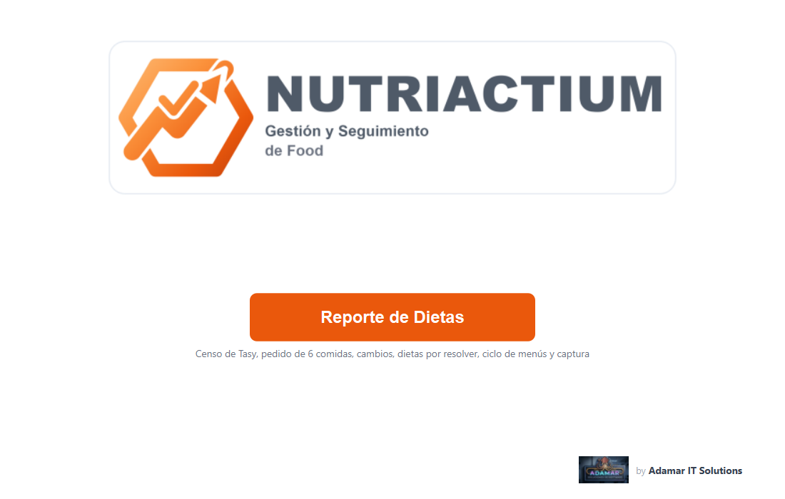
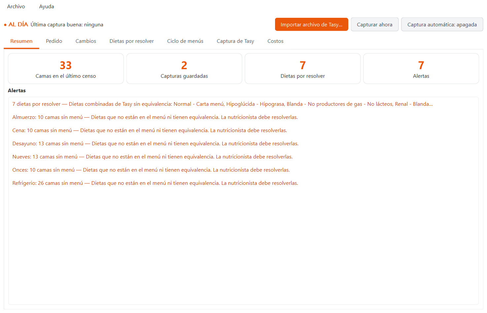
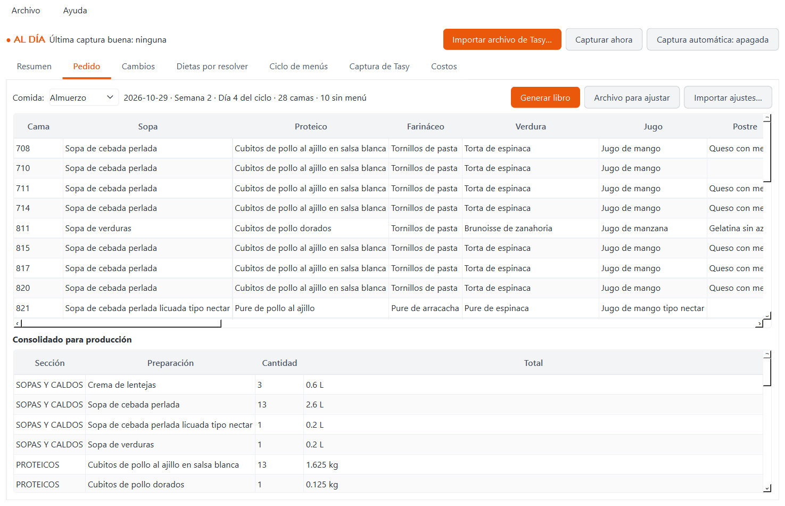
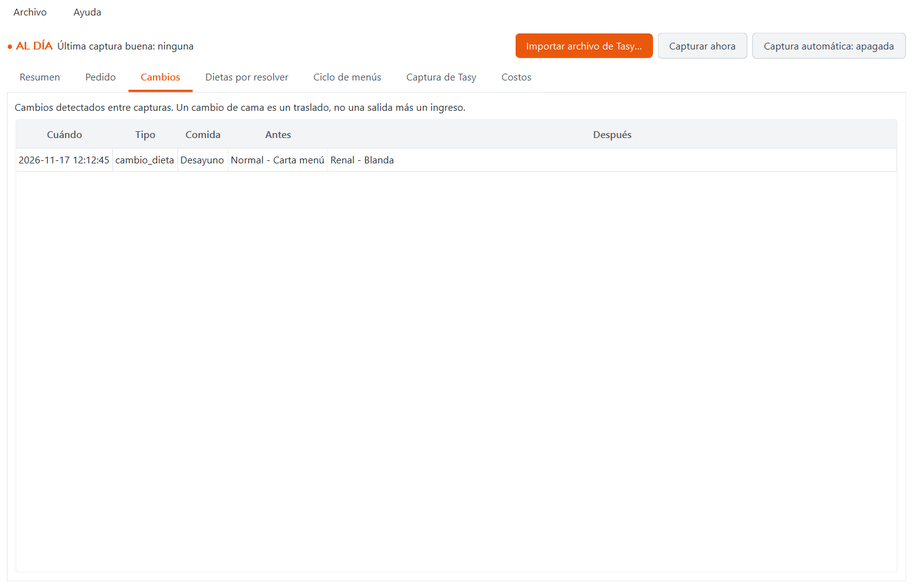
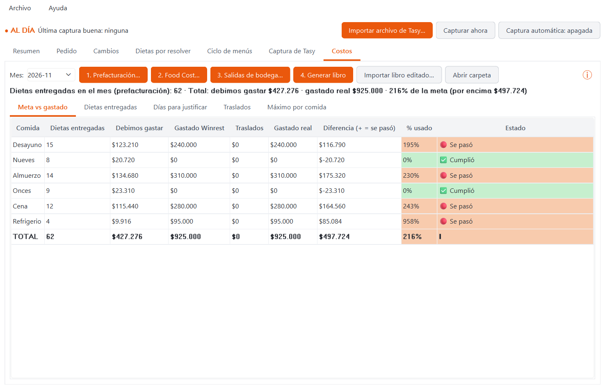
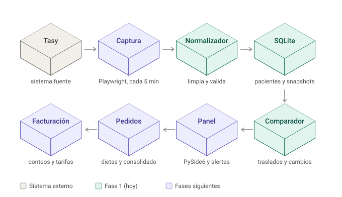

# NutriActium — Hospital Nutrition Operations, Automated

**NutriActium** replaces the manual, copy‑and‑paste cycle that hospital nutrition teams live every day:
downloading the census report every two hours, editing spreadsheets, pasting the patient list into menu orders,
reconciling what was ordered against what was consumed.

> Portfolio showcase. NutriActium is a production codebase for a private hospital deployment — this repository
> documents the engineering. No patient data is anywhere in this repo (or the private one): the sample data is synthetic.

Built by **Nelson Gutiérrez — Adamar IT Solutions**.

## What it does

| Module | Job |
|---|---|
| **Reporte de Dietas** | Imports the hospital information system's census (Tasy), detects admissions, discharges, transfers and diet changes between snapshots, and generates the "Reporte de Dietas" book (censo, comparativa, hoja de ruta) |
| **Pedidos** | Generates the order for six meals (breakfast, nueves, almuerzo, onces, cena, refrigerio nocturno): per‑bed menu plan + production consolidate, validated against the nutritionist's rules |
| **Costos** | Cross‑references what food *should* have cost (billed diets × price + add‑ons) vs what was actually consumed (Winrest Food Cost report), with an editable transfers sheet, floating‑inventory tracking and a "why" diagnosis per day |
| **Ciclo de menús** | 21‑day rotating menu engine (week × day × diet) — the menu that should reach each patient, computed, not looked up manually |
| **Captura** | Playwright automation of the web report (runnable against a fake Tasy server in tests) |

## Screenshots (synthetic data)

| | |
|---|---|
|  |  |
|  |  |
|  | |

## Architecture

Stations of the pipeline (`nutriactium_mapa_estaciones_desarrollo.png` has the full map):

**Capture → Normalize → Snapshot (hash) → Compare (events) → Pedido engine → Excel books → Audit log**

## Engineering highlights

- **Snapshot delta engine.** Every import computes a canonical SHA‑256 over the normalized census. Identical captures are stored nowhere; re‑importing is idempotent. Snapshots are append‑only and always comparable.
- **Correct clinical semantics.** A bed change is a *traslado*, not a discharge + admission. Diet / observation / allergy changes are detected per patient across snapshots.
- **Excel equivalence, measured.** The generated order was diffed cell‑by‑cell against finishing spreadsheets; after two documented Excel defects (trailing‑space diet names) the engine reproduced the final order **100 %**. Recommendations are computed, not guessed.
- **Learned rules, never invented ones.** Combined diets from the source system are resolved once by the nutritionist through an equivalence table; the system remembers and flags them, it doesn't guess clinical intent.
- **Self‑healing ingest.** The upstream report exports with destroyed accents (U+FFFD). The importer deterministically repairs what it recognizes against a closed vocabulary and reports what it can't — never silent guesses on clinical data.
- **Privacy by design.** No patient data in the repo, logs or screens; tests run only on synthetic fixtures; privacy filter masks identifiers defensively.
- **Single portable executable.** PyInstaller build, verified in CI, ships as a folder — no installer, no admin rights required.
- **222 tests passing.** Deterministic, synthetic, headless (offscreen Qt).

## Tech stack

Python 3.10+ · PySide6 · SQLite (migrations + transactional writes) · openpyxl · Playwright · pytest

## Validation

- Equivalence tool: census → Excel books (almuerzo & cena): 34/36 identical beds; 2 differences = Excel defect (stray space in `Hiposódica`), fixed by trimming — 100 % match after the nutritionist's recorded edits.
- End‑to‑end flows tested headless: import → snapshot → pedido → libro → ajustes; capture tested against a fake Tasy server.

## Status

Private production codebase for a hospital nutrition operation. This showcase contains documentation, architecture and screenshots only — source is not published.

## License

MIT (this repository). "NutriActium" name and logo are property of Adamar IT Solutions.
